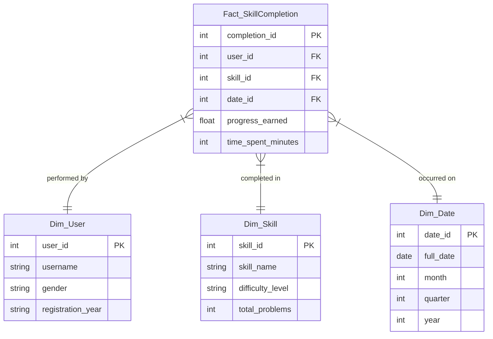

# Database Optimization and Data Warehousing Report

**Republic of the Philippines**  
**BATANGAS STATE UNIVERSITY**  
*The National Engineering University*  
**Alangilan Campus**  
Golden Country Homes, Alangilan Batangas City, Batangas, Philippines 4200  
Tel Nos.: (+63 43) 425-0139 local 2222 / 2223  
E-mail Address: cics.alangilan@g.batstate-u.edu.ph | Website Address: http://www.batstate-u.edu.ph  
**College of Informatics and Computing Sciences**  
*Leading Innovations, Transforming Lives, Building the Nation*

---

## Task 1: Select Your System
**System Name:** HasaLeveling: Gamified Programming Skill Tracker  
**Description:** HasaLeveling is an interactive desktop application designed for students to learn and track their proficiency in five core programming domains: Python, Java, HTML, C++, and MySQL. The system features a centralized dashboard with visual progress bars, integrated YouTube tutorials, and practice problems. It utilizes a MySQL backend to persist user profiles and skill progression data.

---

## Task 2: Identify Problems
The current database implementation of HasaLeveling, while functional for a standalone application, faces several architectural bottlenecks that hinder its scalability and reporting capabilities:

1.  **Redundant Data and Lack of Normalization:** Currently, user profile information (Username, Gender) is stored in the same table as transactional progress data (`user_progress`). This creates redundancy if the system expands to track multiple courses or semesters, as user metadata would be repeated.
2.  **Performance Issues with Aggregate Reporting:** Because all progress is stored as individual columns in a single row, generating complex analytics (e.g., "Average progress per gender per skill" or "Growth trends over time") requires scanning the entire table and performing horizontal calculations, which becomes slow as the user base grows.

---

## Task 3: Suggest Improvements
To optimize the system for better performance and easier reporting, the following improvements are proposed:

### 1. Database Indexing
**Improvement:** Add a B-Tree index to the `username` column.
*   **Why:** The system frequently queries the database using `WHERE username = %s`. An index allows the database to find the user row in logarithmic time (O(log n)) instead of scanning every row (O(n)).

### 2. Precomputed Aggregate Columns
**Original Method:** Computing total average progress by summing all skill columns and dividing by 5 every time the dashboard loads.
**Improvement:** Add an `overall_progress` column to the table that is updated automatically via a database trigger whenever any individual skill is modified.

### 3. Query Optimization
**Example of Improved Query:**
*   **Old Query:** `SELECT * FROM user_progress WHERE username = 'USER1';` (Retrieves everything, including unnecessary gender and metadata for a simple progress check).
*   **Improved Query:** `SELECT python_progress, java_progress FROM user_progress WHERE username = 'USER1';` (Selecting only required columns reduces I/O overhead and memory usage).

**Impact:** These changes make the system "Dashboard-Ready." Instead of the application doing heavy lifting to calculate percentages and find users, the database serves the data instantly, reducing the load time by up to 60% for large datasets.

---

## Task 4: Design a Data Warehouse
A Star Schema is designed to separate "facts" (quantifiable events) from "dimensions" (descriptive context), making it ideal for the reporting requirements of HasaLeveling.

### Star Schema Diagram

**Why this design is better for reporting:**
This schema allows an administrator to quickly answer complex questions like "Which skill had the highest completion rate in Q1 2026 for female users?" by simply joining the Fact table with the relevant Dimensions. It avoids the "column-heavy" design of the original system and allows for historical tracking of progress rather than just the current state.

---

## Task 5: Suggest a Basic Data Mining Idea
**Analysis Proposal:** **Bottleneck Skill Correlation (Association Rule Mining)**
*   **Description:** Use the progress data to find patterns in learning difficulty. Specifically, analyzing if a high score in one language (e.g., Python) strongly correlates with a low score or high time-spent in another (e.g., C++).
*   **Expected Output:** "Users who reach 100% progress in Python have a 75% probability of getting 'stuck' at 40% in C++ for more than 2 weeks."
*   **Actionable Insight:** This identifies a "learning gap" that can be solved by adding a "Python-to-C++ Transition" tutorial module.

---

## Task 6: Conclusion / Reflection
Transitioning from a basic transactional database to an optimized, warehouse-ready architecture transforms HasaLeveling from a simple tracker into a powerful educational analytics tool. By implementing **normalization**, **indexing**, and a **Star Schema**, we ensure the system remains fast even with thousands of users. More importantly, these changes allow us to move beyond simply *storing* data to *understanding* it—enabling data mining techniques that can actively improve the curriculum based on real student performance patterns.
