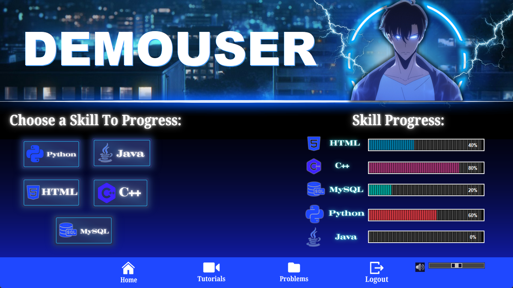
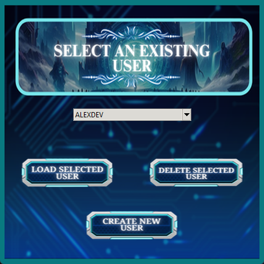
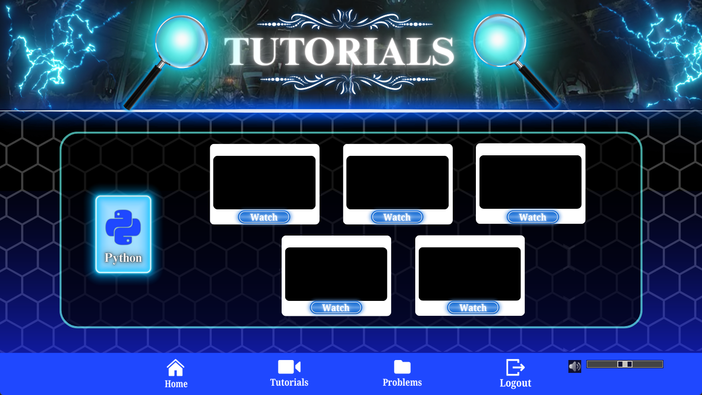
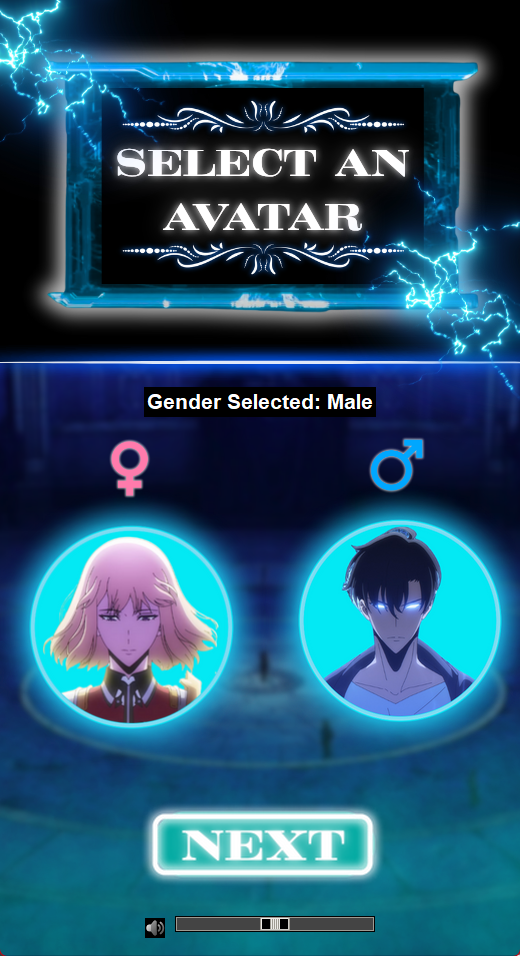
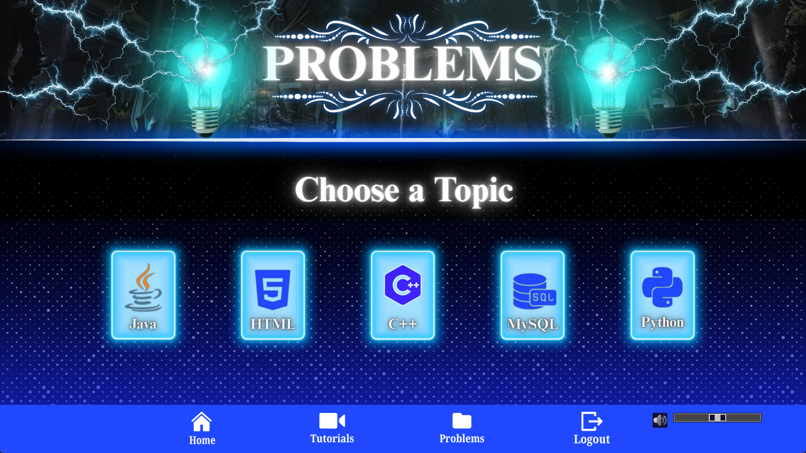
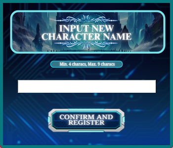
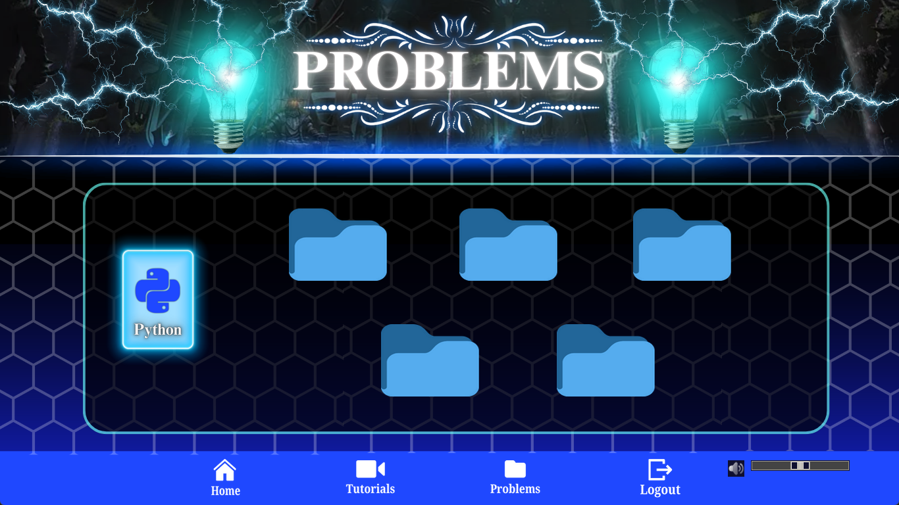
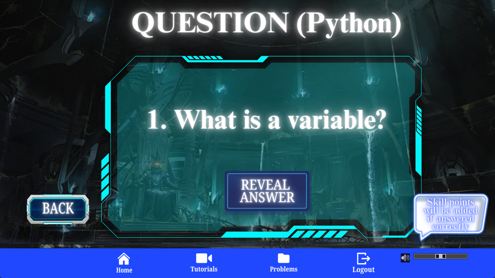
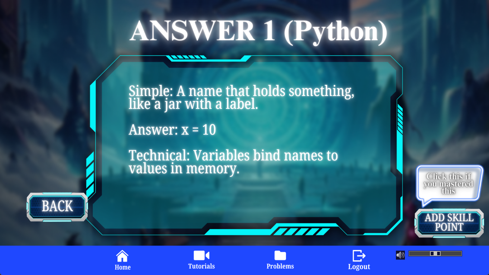

<!-- prettier-ignore -->
<div align="center">


# HasaLeveling — Gamified Programming Skill Tracker

*Hasa Kabataan: Solo Leveling — level up your programming skills.*

[](https://www.python.org)
[](https://docs.python.org/3/library/tkinter.html)
[](https://www.mysql.com)
[](https://www.pygame.org)

[Overview](#overview) • [Screenshots](#screenshots) • [Features](#features) • [Getting started](#getting-started) • [Usage](#usage) • [Project structure](#project-structure) • [Database schema](#database-schema) • [Troubleshooting](#troubleshooting)



</div>

HasaLeveling is a desktop skill-tracking application for student developers, inspired by the progression system of the manhwa *Solo Leveling*. Instead of a plain checklist, your learning journey becomes a game: pick a character, choose a skill, watch curated tutorials, solve problems, and watch your progress bars fill up — all persisted in a MySQL database.

It tracks five core programming skills — **Python, Java, HTML, C++, and MySQL** — through a dashboard with animated progress bars, a built-in tutorial hub, and a problem-solver module that rewards completed challenges with skill points.

> [!TIP]
> The quickest way to try it out: follow [Getting started](#getting-started), then click **Access → Create New User** and you'll be on the dashboard in under a minute.

## Overview

HasaLeveling was built to answer a simple problem: students often lose motivation when tracking their self-study across multiple programming languages. Existing tools are either purely utilitarian or give no visual feedback.

This project addresses that with:

- A *Solo Leveling*–themed interface — character avatars, dynamic backgrounds, background music, sounds, and hover-animated buttons.
- A profile system backed by **MySQL**, so progress survives across sessions.
- A **portrait main menu** for login and registration, and a **landscape dashboard** (1366×768) for the actual skill-tracking experience.
- A feedback loop — solve a problem, reveal the answer, and claim **+20% skill progress** if you mastered it.

## Screenshots

<!-- prettier-ignore -->
| Portrait flow — login and registration | Landscape view — dashboard and quests |
| --- | --- |
|  |  |
|  |  |
|  |  |
|  |  |
| |  |
| |  |

## Features

- **User profile management** — create, load, and delete profiles; each stores a username (4–9 characters), avatar gender, and skill progress in MySQL.
- **Gamified dashboard** — giant username banner, animated character avatar, and segmented progress bars for all five skills, refreshed straight from the database on every visit.
- **Learning hub** — curated YouTube tutorial playlists for each skill, opened directly in your browser via five "Watch" buttons per skill.
- **Problem solver** — 5 problems per skill (25 total) with a *Reveal Answer* flow, followed by an *Add Skill Point* button that raises that skill by **+20%** (capped at 100%) and writes it to the database.
- **Polish** — background music with a volume slider, click sound effects, pulsing hover animations, and confirmation dialogs for destructive actions.

## Getting started

### Prerequisites

- [Python 3.10+](https://www.python.org/downloads/)
- [MySQL Server](https://dev.mysql.com/downloads/mysql/) (8.0 recommended; XAMPP or MySQL Workbench both work)
- A screen with at least **1366×768** resolution (the landscape dashboard is a fixed-size window)
- Speakers or headphones for the background music (optional)

### 1. Get the code

```bash
git clone https://github.com/bitancutiepie/HasaKabataan.git
cd HasaKabataan
```

Or download the repository ZIP and extract it. Keep the `assets` folder next to `HasaLeveling.py`.

### 2. Install the Python packages

```bash
pip install pillow pygame mysql-connector-python
```

| Package | Purpose |
| --- | --- |
| `tkinter` | GUI framework (bundled with Python) |
| `pillow` | Image loading and resizing |
| `pygame` | Background music and sound effects |
| `mysql-connector-python` | Database connectivity |

### 3. Set up the MySQL database

Make sure the MySQL service is running (on Windows, check the **MYSQL80** service in `services.msc`), then run:

```sql
CREATE DATABASE hasaleveling_db;
USE hasaleveling_db;

CREATE TABLE user_progress (
    username           VARCHAR(9)    PRIMARY KEY,
    gender             VARCHAR(10)   NOT NULL,
    html_progress      DECIMAL(3,2)  NOT NULL DEFAULT 0.10,
    cplusplus_progress DECIMAL(3,2)  NOT NULL DEFAULT 0.10,
    mysql_progress     DECIMAL(3,2)  NOT NULL DEFAULT 0.10,
    python_progress    DECIMAL(3,2)  NOT NULL DEFAULT 0.10,
    java_progress      DECIMAL(3,2)  NOT NULL DEFAULT 0.10,
    CHECK (html_progress      BETWEEN 0.00 AND 1.00),
    CHECK (cplusplus_progress BETWEEN 0.00 AND 1.00),
    CHECK (mysql_progress     BETWEEN 0.00 AND 1.00),
    CHECK (python_progress    BETWEEN 0.00 AND 1.00),
    CHECK (java_progress      BETWEEN 0.00 AND 1.00)
);
```

### 4. Configure the database connection

Open `HasaLeveling.py` and update `DB_CONFIG` with your local MySQL credentials:

```python
DB_CONFIG = {
    "host": "localhost",
    "user": "root",
    "password": "your_mysql_password",   # <-- change this
    "database": "hasaleveling_db"
}
```

> [!IMPORTANT]
> The `password` in `DB_CONFIG` must match the password of your local MySQL setup. If it doesn't, the app will show a "Database Connection Error" dialog on startup.

### 5. Run the application

```bash
python HasaLeveling.py
```

The app opens in a portrait window with the main menu. See [Usage](#usage) for the full flow.

> [!NOTE]
> A step-by-step printable version of these instructions (with screenshots of each step) is bundled in the repository as [`SETUP ACP FINAL.pdf`](SETUP%20ACP%20FINAL.pdf).

## Usage

1. **Main menu** — click **Access** to start (or **Exit** to close the app).
2. **User profiles** — load an existing user from the dropdown, delete a profile, or click **Create New User**.
3. **Character selection** — pick the Male or Female avatar, then click **Next**.
4. **Registration** — enter a username (4–9 characters) and click **Register**. You land on the dashboard immediately.
5. **Dashboard** — the left side lists the five skills; the right side shows your progress bars. The bottom navigation bar switches between **Home**, **Tutorials**, **Problems**, and **Logout**.
6. **Tutorials** — click a skill button on the dashboard (or open the Tutorials tab and pick a topic), then press one of the five **Watch** buttons to open a curated YouTube playlist in your browser.
7. **Problems** — open the **Problems** tab, choose a topic, and click a numbered folder (1–5) to view a question.
8. **Reveal & level up** — click **Reveal Answer** to see the solution. If you understood it, click **Add Skill Point** to gain **+20%** in that skill; the dashboard updates instantly. At 100% the button is replaced with "SKILL MAXED!".
9. **Sign out / exit** — the nav bar's **Logout** button (or the window's X) returns you to the main menu after a confirmation prompt.

## Project structure

```
HasaLeveling/
├── HasaLeveling.py            # The entire application: screens, animations, and DB access
├── assets/                    # Images, backgrounds, music, and sound effects
│   ├── bgmusic.mp3            # Background music (looped)
│   ├── clicksoundeffect.wav   # UI click sound effect
│   ├── logoicon.png           # Application icon
│   ├── dashboard.png          # Dashboard background (one per screen: bg.png, bg2.png, ...)
│   ├── question*.png          # Problem statements (questionpython1.png, questionc1.png, ...)
│   ├── answer*.png            # Answer screens  (answerpython1.png, answerc1.png, ...)
│   └── ...                    # Buttons, skill icons, avatars, and other UI art
├── screenshots/               # Screenshots used in this README
├── Database_Report.md         # Database optimization and data-warehouse report
└── SETUP ACP FINAL.pdf        # Printable setup and installation guide
```

## Database schema

All state lives in a single MySQL table, `hasaleveling_db.user_progress`:

| Column | Type | Notes |
| --- | --- | --- |
| `username` | `VARCHAR(9)` | Primary key; stored uppercase (e.g. `DEMOUSER`) |
| `gender` | `VARCHAR(10)` | `Male` or `Female`; decides the dashboard avatar |
| `html_progress` | `DECIMAL(3,2)` | 0.00 – 1.00, default `0.10` |
| `cplusplus_progress` | `DECIMAL(3,2)` | 0.00 – 1.00, default `0.10` |
| `mysql_progress` | `DECIMAL(3,2)` | 0.00 – 1.00, default `0.10` |
| `python_progress` | `DECIMAL(3,2)` | 0.00 – 1.00, default `0.10` |
| `java_progress` | `DECIMAL(3,2)` | 0.00 – 1.00, default `0.10` |

Progress is incremented by `0.20` per completed problem and clamped with `LEAST(column + increment, 1.0)`, so it can never exceed 100%.

> [!TIP]
> Curious how this schema could be normalized, indexed, and turned into a reporting-ready star schema? See the full analysis in [`Database_Report.md`](Database_Report.md).

## Troubleshooting

- **"Database Connection Error" on startup** — verify the MySQL service is running and that `DB_CONFIG` credentials match your setup. On Windows, start the `MYSQL80` service.
- **`Warning: Asset not found` printed in the console** — an image or audio file listed in `HasaLeveling.py` is missing from `assets/`. Keep the folder next to the script and don't rename its files.
- **No music or sound effects** — check that `pygame` is installed and `assets/bgmusic.mp3` and `assets/clicksoundeffect.wav` exist. The app runs fine without audio.
- **The dashboard doesn't fit on screen** — the landscape window is designed for 1366×768. Higher resolutions work; smaller ones may clip the window.

## Resources

- [Python `tkinter` documentation](https://docs.python.org/3/library/tkinter.html)
- [Pillow documentation](https://pillow.readthedocs.io)
- [pygame documentation](https://www.pygame.org/docs/)
- [MySQL Connector/Python documentation](https://dev.mysql.com/doc/connector-python/en/)

---

Developed by **Adrian G. Balbuena** and **Joshua Vincent M. Bitancor** for CS 121 — Batangas State University, College of Informatics and Computing Sciences.
